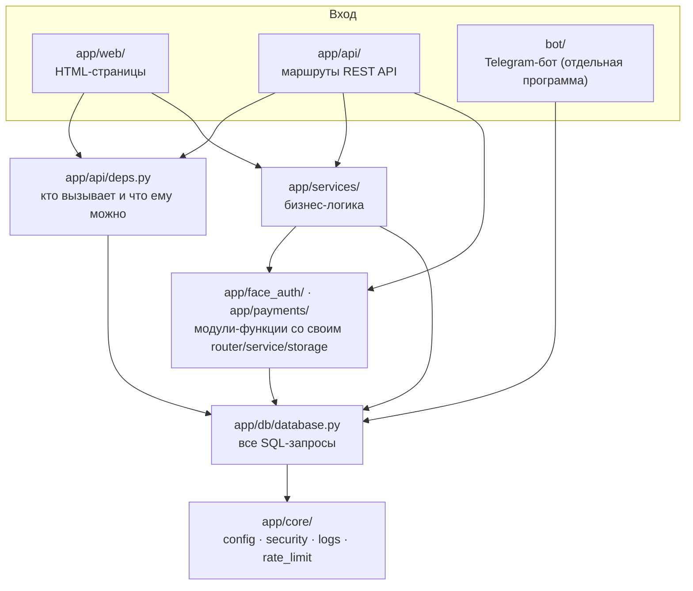

# Архитектура Microfinance IS

Код разложен по **слоям**. Каждый слой отвечает за одно и знает только о слоях **ниже** себя.
Так новую функцию легко добавить, не ломая остальное, а правила безопасности проверяются в одном месте.

## Слои

| Слой | Папка | Что делает | Чего НЕ делает |
|---|---|---|---|
| Маршруты API | `app/api/` | принимает HTTP-запрос, проверяет тело (Pydantic), права доступа, пишет аудит, возвращает JSON | не считает бизнес-правила и не пишет в базу напрямую |
| Страницы | `app/web/` | HTML-формы входа, регистрации, кабинеты | — то же, что API: формы вызывают те же сервисы |
| Права доступа | `app/api/deps.py` | JWT → пользователь; 401 без входа, 403 к чужим данным, «только сотрудник» | — |
| Бизнес-логика | `app/services/` | правила одобрения, выдача кредита, график, регистрация, оплата | ничего не знает про HTTP: бросает `NotFoundError` / `RuleError`, их переводит в ответ `app/main.py` |
| База данных | `app/db/database.py` | все SQL-запросы с параметрами `?` | не принимает решений |
| Ядро | `app/core/` | настройки, пароли и JWT, логи, лимиты запросов | не зависит ни от одного слоя выше |
| Модули-функции | `app/face_auth/`, `app/payments/` | вертикальные «срезы» со своими router/service/storage | — |
| Бот | `bot/` | Telegram-бот и команды оператора | не импортирует веб-код, общая только база и настройки |

**Правило:** импорты идут только сверху вниз.
- `app/core` не импортирует ничего из остального проекта.
- `app/services` и `app/db` не импортируют `app/api` и `app/web`. Поэтому `app/face_auth/__init__.py` и
  `app/payments/__init__.py` не подгружают свои роутеры: роутеры подключает только `app/main.py`.
- Веб-приложение (`app/`) не импортирует бота (`bot/`): это проверяет тест в `tests/test_telegram.py`.
- Исключение, которое стоит знать: `app/face_auth/gate.py` и `app/payments/service.py` бросают
  `HTTPException` прямо из своих проверок (так было до разделения на слои, поведение сохранено).

## Путь одного запроса: клиент подаёт заявку

`POST /api/applications` с токеном и `face_token`:

1. **`app/main.py`** — middleware пишет строку в `logs/app.log`, slowapi считает лимит `MFO_RATE_LIMIT_SUBMIT`.
2. **`app/api/applications.py`** — Pydantic проверяет тело (`ApplicationIn` в `schemas.py`).
3. **`app/api/deps.py`** — `authenticate()` проверяет JWT (`app/core/security.py`), `ensure_own_client()` — что клиент подаёт за себя.
4. **`app/face_auth/gate.py`** — одноразовый `face_token` после проверки лица, иначе 403.
5. **`app/services/loans.py`** — `submit_application()`: доход из базы, правило из `approval.py`, автопроверки, при одобрении — кредит и график.
6. **`app/db/database.py`** — INSERT-ы в `loan_applications`, `client_checks`, `loans`, `repayments`.
7. Обратно в **`app/api/applications.py`** — запись `application_submitted` в `logs/audit.log`, ответ JSON.

## Настройки

Все настройки — в **`app/core/config.py`**: путь к базе, лимиты запросов, секрет JWT, пороги проверки лица,
настройки бота и сервера. Порядок: переменная окружения → файл `.env` → значение по умолчанию.

Неверное значение **никогда не отключает защиту**: подставляется значение по умолчанию, а проблема
запоминается. `check_settings()` возвращает список проблем без секретных значений:
- сайт при старте пишет их в лог как WARNING;
- `run.py` печатает их перед запуском, а при неустранимых ошибках (порт, хост, id сотрудников, нет токена бота) не стартует.

## Как добавить новую функцию

1. SQL-запросы — в `app/db/database.py` (или своё `storage.py`, как у `face_auth`).
2. Правила и операции — новый модуль в `app/services/`, ошибки через `app/services/errors.py`.
3. Маршруты — новый модуль в `app/api/` с `router = APIRouter()`, права через `app/api/deps.py`.
4. Подключить в `app/main.py` через `add_routes(...)`, настройки — в `app/core/config.py` и `.env.example`.
5. Тесты — в `tests/`, фикстуры `client`, `staff`, `as_user` уже есть в `conftest.py`.

> Почему `add_routes`, а не `app.include_router`: в FastAPI 0.16x подключённый роутер хранится одним
> объектом, и slowapi его не видит — лимит по умолчанию молча переставал работать. Это проверяет
> `tests/test_rate_limit.py::test_other_endpoints_have_default_limit_each`.
