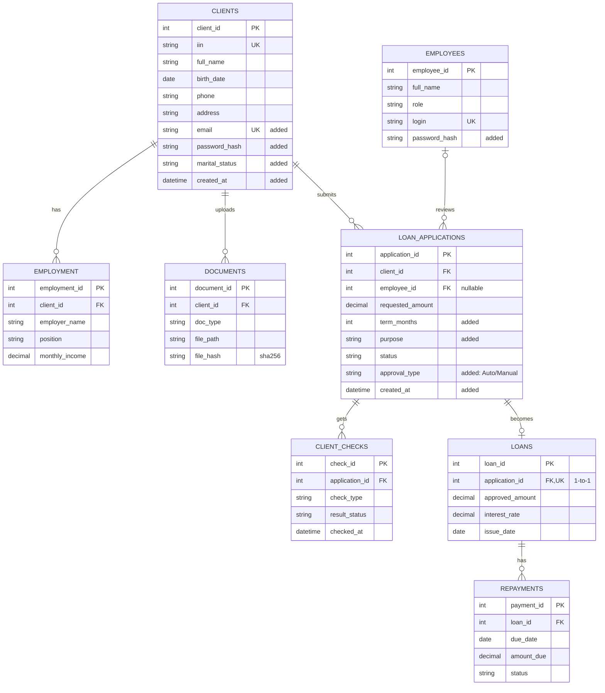

# ERD: Microfinance IS

Схема совпадает с ERD команды. Поля, которые мы **добавили** для регистрации и входа, помечены в комментариях
(`added`): `clients.email`, `clients.password_hash`, `clients.marital_status`, `clients.created_at`,
`employees.password_hash`, а также `loan_applications.term_months`, `purpose`, `approval_type`, `created_at`.

## Связи и правила удаления

| Связь | Тип | FOREIGN KEY | При удалении родителя |
|-------|-----|-------------|------------------------|
| clients → employment (has) | 1 : N | `employment.client_id → clients.client_id` | CASCADE |
| clients → documents (uploads) | 1 : N | `documents.client_id → clients.client_id` | CASCADE |
| clients → loan_applications (submits) | 1 : N | `loan_applications.client_id → clients.client_id` | CASCADE |
| employees → loan_applications (reviews) | 0..1 : N | `loan_applications.employee_id → employees.employee_id` (может быть NULL) | SET NULL |
| loan_applications → client_checks (gets) | 1 : N | `client_checks.application_id → loan_applications.application_id` | CASCADE |
| loan_applications → loans (becomes) | 1 : 0..1 | `loans.application_id` (UNIQUE) → `loan_applications.application_id` | CASCADE |
| loans → repayments (has) | 1 : N | `repayments.loan_id → loans.loan_id` | CASCADE |

Внешние ключи в SQLite работают только после `PRAGMA foreign_keys = ON`. Это включается в `database.get_connection()` для каждого соединения.

Типы в SQLite: `decimal` хранится как `REAL`, `date`/`datetime` хранятся как `TEXT` в формате ISO (`2026-11-02`, `2026-11-02 15:00:00`).
