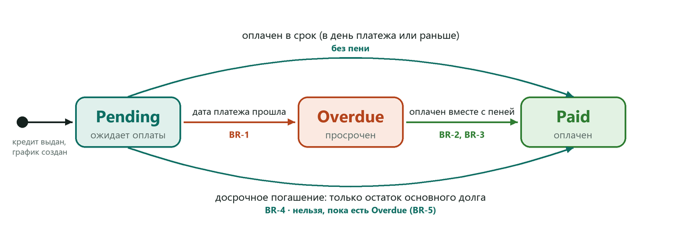

# Правила погашения: просрочка, пеня, досрочное погашение

**Роль:** Systems Analysis & Requirements
**Проект:** Microfinance IS, BIS Fall 2026 · **Код:** `app/repayment_rules/` · **Тесты:** `tests/test_repayment_rules.py`

## 1. Чем эта часть отличается от payment methods

| Вопрос | Роль | Где в коде |
|---|---|---|
| **Как** клиент платит: карта, PayPal, Kaspi QR | Application & Development | `payments/` |
| **Что и когда** клиент должен заплатить: просрочка, пеня, досрочное погашение | Systems Analysis & Requirements | `app/repayment_rules/` |

До этой части у платежа было два состояния: `Pending` и `Paid`. Система не замечала, что клиент опоздал,
и не давала закрыть кредит раньше срока. Для МФО это главный процесс после выдачи займа.

## 2. Бизнес-правила (требования)

| ID | Правило | Как проверяется |
|---|---|---|
| **BR-1** | Платёж, не оплаченный после даты платежа, получает статус **Overdue**. В сам день платежа он ещё не просрочен. | `test_overdue_starts_the_day_after_the_due_date` |
| **BR-2** | Пеня: **0,5% от суммы платежа за каждый день просрочки**, но не больше **50%** суммы платежа, чтобы долг не рос бесконечно. | `test_penalty_is_half_percent_per_day_with_a_cap` |
| **BR-3** | Просроченный платёж оплачивается **вместе с пеней** любым способом (карта / PayPal / Kaspi QR / в офисе). Пеня сохраняется в истории. | `test_overdue_payment_is_paid_with_its_penalty`, `test_kaspi_qr_amount_includes_the_penalty` |
| **BR-4** | **Досрочное погашение**: клиент закрывает весь кредит сразу и платит только **остаток основного долга**, без процентов за будущие месяцы и без комиссии. | `test_early_payoff_closes_the_loan_for_the_principal_only` |
| **BR-5** | Досрочное погашение **запрещено, пока есть просрочка**: сначала нужно оплатить просроченные платежи. | `test_early_payoff_is_blocked_while_something_is_overdue` |
| **BR-6** | Закрыть чужой кредит нельзя. Сотрудник может закрыть кредит в офисе (manual). Kaspi QR работает только для одного платежа. | `test_early_payoff_checks_method_and_owner` |

> Ставка 0,5% в день и потолок 50% являются допущениями прототипа и задаются константами в
> `app/repayment_rules/rules.py` (`PENALTY_RATE_PER_DAY`, `PENALTY_CAP_SHARE`). Перед реальным использованием их
> нужно сверить с действующими требованиями регулятора к МФО.

## 3. Жизненный цикл платежа



**Важное решение:** статус `Overdue` **не хранится** в базе, а **вычисляется** из `due_date` и текущей даты.
- Не нужен фоновый процесс, который каждую ночь переписывает статусы.
- В базе остаются старые значения `Pending` / `Paid`, поэтому код команды (бот, админка, счётчик
  «Paid 3/12») работает без изменений.
- Статус всегда точный: в 00:00 следующего дня платёж сразу считается просроченным.

## 4. Пример на цифрах

Кредит **100 000 ₸** на **12 месяцев** под **24% годовых**, ежемесячный платёж **9 455,96 ₸**.

**Пеня (BR-2):**

| Просрочка | Пеня | К оплате |
|---|---|---|
| 0 дней | 0 ₸ | 9 455,96 ₸ |
| 10 дней | 472,80 ₸ | 9 928,76 ₸ |
| 30 дней | 1 418,39 ₸ | 10 874,35 ₸ |
| 100+ дней | 4 727,98 ₸ (потолок 50%) | 14 183,94 ₸ |

**Досрочное погашение (BR-4).** Остаток долга по формуле аннуитета:
`B_k = S·(1+r)^k − P·((1+r)^k − 1)/r`, где `S` = сумма кредита, `r` = 2% в месяц, `P` = платёж, `k` = сколько платежей уже оплачено.

| Оплачено платежей | Осталось по графику | Заплатить досрочно | Экономия клиента |
|---|---|---|---|
| 0 | 113 471,52 ₸ | 100 000,00 ₸ | 13 471,52 ₸ |
| 1 | 104 015,56 ₸ | 92 544,04 ₸ | 11 471,52 ₸ |
| 3 | 85 103,64 ₸ | 77 181,78 ₸ | 7 921,86 ₸ |
| 6 | 56 735,76 ₸ | 52 966,90 ₸ | 3 768,86 ₸ |

## 5. Что добавлено в систему

**Таблицы** (создаются автоматически, старая `mfo.db` обновляется сама, `database.py` не менялся):

| Таблица | Зачем |
|---|---|
| `repayment_penalties` | Какая пеня реально оплачена за платёж и за сколько дней (FK → `repayments`) |
| `early_payoffs` | Досрочное погашение кредита: сумма, способ, кто, когда. Один раз на кредит (`loan_id UNIQUE`, FK → `loans`) |
| `early_payoff_items` | Какие платежи графика закрыты досрочным погашением (FK → `repayments`, `early_payoffs`) |

Досрочное погашение сохраняется **одной транзакцией**: сохраняются либо все записи, либо ни одной.

**API:**

| Метод | Адрес | Что делает |
|---|---|---|
| GET | `/api/loans/{id}/repayments` | График получил новые поля: `display_status`, `days_overdue`, `penalty`, `total_to_pay`, `closed_early` |
| POST | `/api/repayments/{id}/pay` | Если платёж просрочен, к сумме добавляется пеня (в ответе есть `penalty` и `total_paid`) |
| GET | `/api/loans/{id}/early-payoff` | Расчёт: можно ли закрыть кредит сегодня, сколько платить, какая экономия |
| POST | `/api/loans/{id}/early-payoff` | Закрыть кредит: `{"method": "card"}` / `paypal` / без тела (в офисе) |

**Дашборд клиента:** просроченные строки подсвечены красным, показаны дни просрочки и пеня. Под графиком
находится блок «Досрочное погашение» с суммой и экономией. Для оплаты открывается то же окно оплаты, что и для
обычного платежа (карта / PayPal).

## 6. Как показать на защите

Даты можно «перемотать» переменной `MFO_TODAY`, ждать месяц не нужно:

```powershell
cd mfo-prototype
$env:MFO_TODAY = "2027-02-05"     # «сегодня» = 5 февраля 2027
python run.py --web-only
```

1. Войти клиентом с выданным кредитом и открыть **Schedule**: первые платежи красные, видны `Overdue`, дни и пеня.
2. Блок «Досрочное погашение» пишет, что погасить досрочно нельзя, пока есть просрочка (BR-5).
3. Оплатить просроченный платёж: сумма в окне оплаты уже включает пеню (BR-3).
4. Когда просрочки нет, нажать «Погасить досрочно»: все платежи становятся `Paid`, счётчик показывает 12/12 (BR-4).

Без `MFO_TODAY` система работает с настоящей датой.

## 7. Тесты

```powershell
cd mfo-prototype
python -m pytest tests/test_repayment_rules.py -v
```

11 тестов: 3 на чистые правила (пеня, просрочка, формула остатка) и 8 через API (график, оплата с пеней,
Kaspi QR с пеней, запрет досрочки при просрочке, досрочное погашение, права доступа, дашборд).
